# 🏛️ DealRoom: an AI investment committee for SEC filings

[](https://github.com/balum211/DealRoom/actions/workflows/ci.yml)


**Team 24 · The Gen Academy, Mastering Agentic AI · Demo Day 2026**

DealRoom is a team of AI agents that does a junior analyst's first pass of due diligence in seconds. It reads
SEC 10-K filings, has a **Bull** agent and a **Bear** agent argue the case from the same evidence, has a
**Verifier** check every claim against the page it cites, and hands a **human reviewer** a one-page memo where
every claim links back to its filing page.

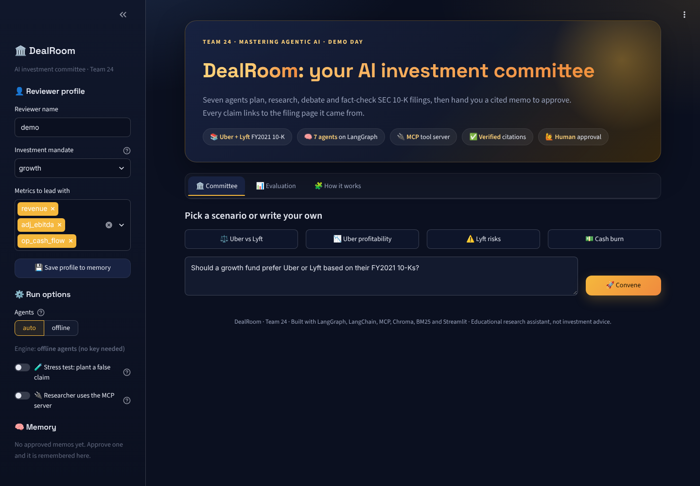

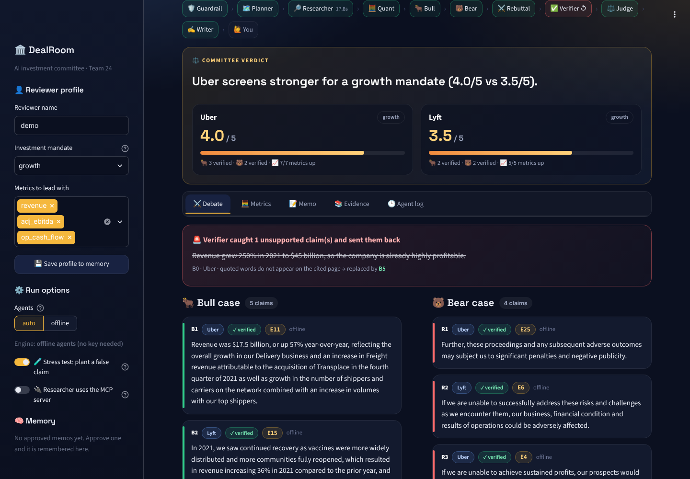

| Verifier catches a planted claim | Metrics from the filings' tables | Cited memo for human approval |
|---|---|---|
| 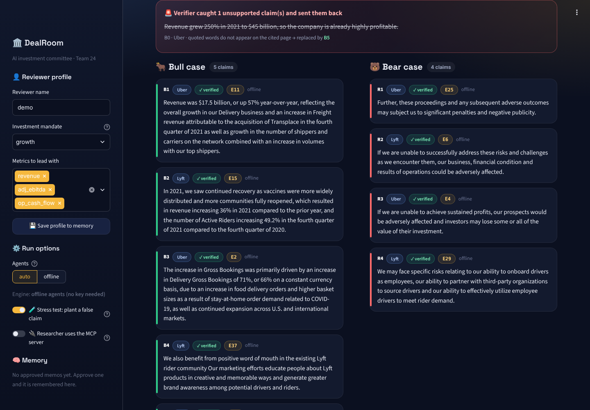 | 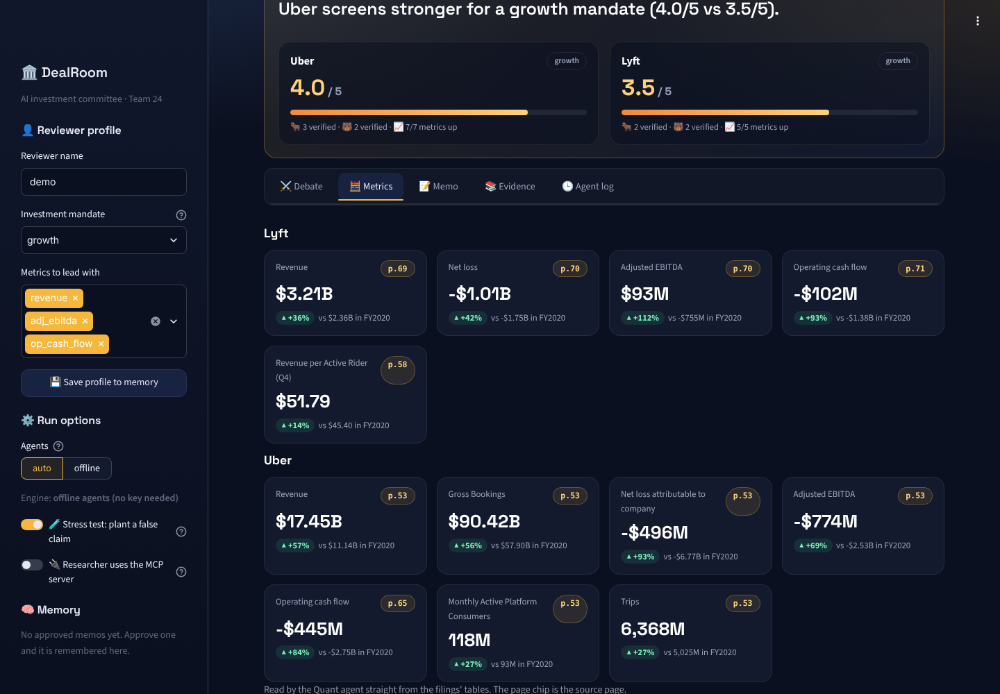 | 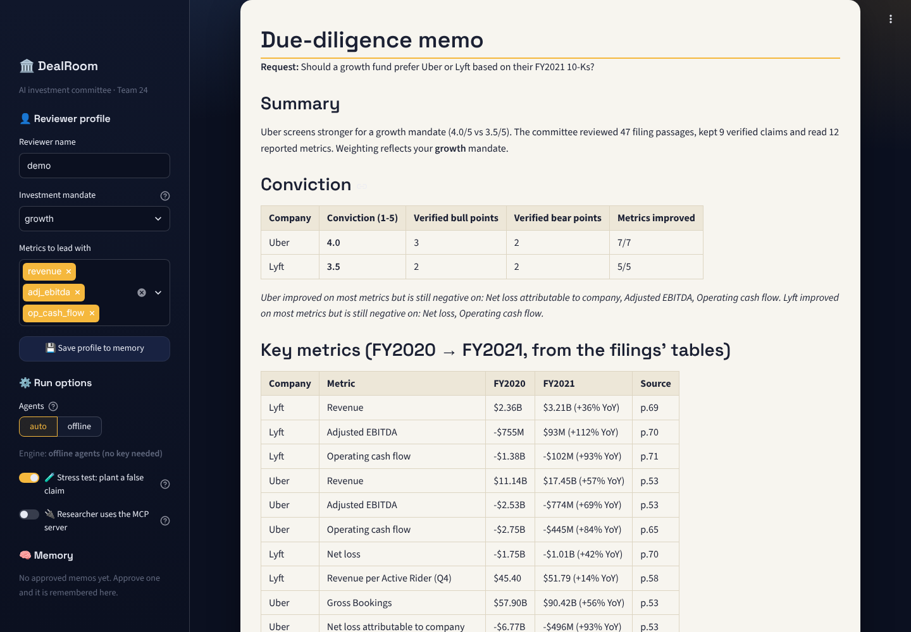 |

| Exact filing text behind every citation | Agent log: time, LLM calls, tokens and cost | Approved memo saved to memory |
|---|---|---|
| 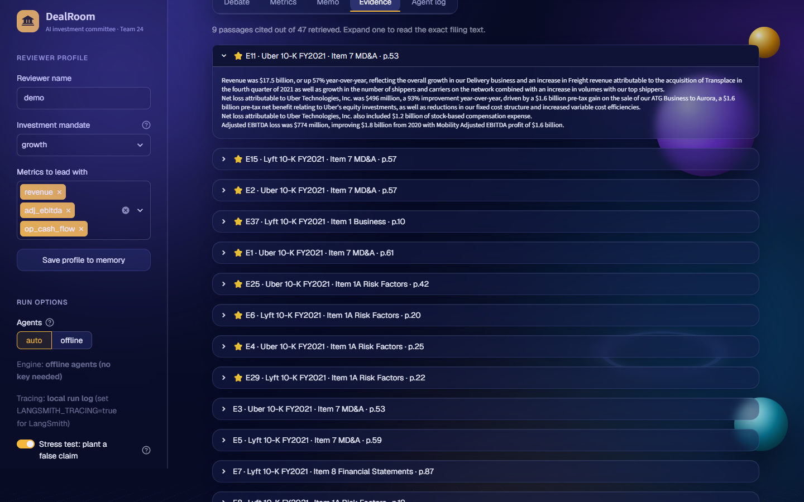 | 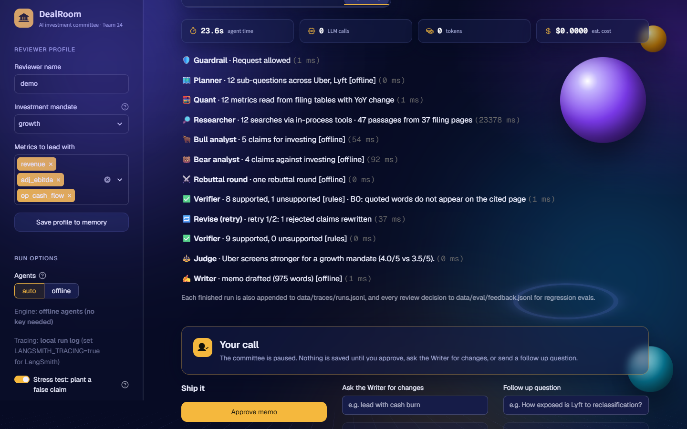 | 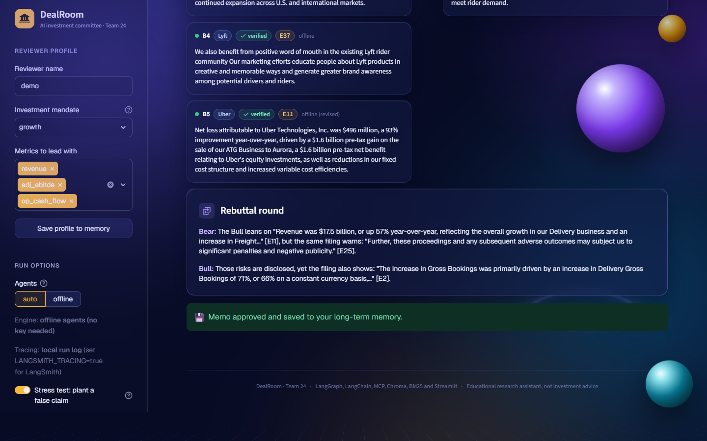 |

| Evaluation report | Course map: Weeks 1 to 5 in DealRoom |
|---|---|
| 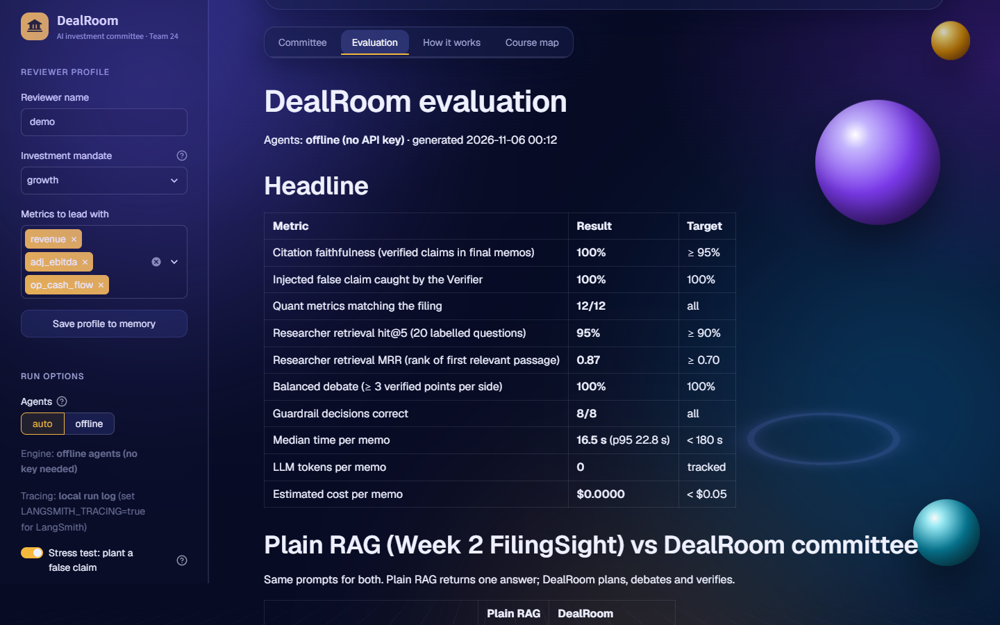 | 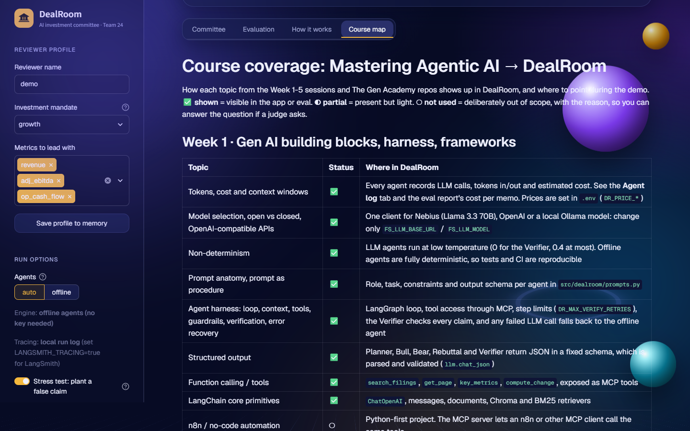 |

## Why it is agentic, not just RAG

| Capability | How DealRoom does it |
|---|---|
| Planning | A Planner splits one request into sub-questions per company: growth, profitability, cash, risks, strategy, plus your focus |
| Tool use + MCP | Researcher runs hybrid search; Quant reads figures straight from the filings' tables. The same tools are served by an **MCP server** |
| Multi-agent debate | Bull and Bear run in parallel on the same evidence, then a rebuttal round; a Judge scores conviction 1-5 |
| Self-correction | The Verifier rejects claims whose quote is not on the cited page or whose numbers are not in the source, and loops them back for a rewrite (max 2) |
| Human in the loop | LangGraph `interrupt()` pauses before anything is saved: approve, request changes, or ask a follow-up |
| Memory | Thread memory in the LangGraph checkpointer; long-term reviewer memory (mandate, preferred metrics, past memos) that changes the Judge's weighting |
| Guardrails | Prompt-injection and scope checks on input, injection stripping on retrieved text, no buy/sell advice in output, disclaimer always added |

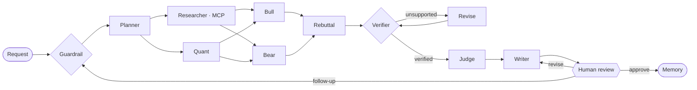

More detail: [docs/ARCHITECTURE.md](docs/ARCHITECTURE.md) · Proposal: [docs/PROPOSAL.md](docs/PROPOSAL.md) · Course topics covered: [docs/COURSE_COVERAGE.md](docs/COURSE_COVERAGE.md)

## Results

Offline agents, no API key:

| Metric | Result | Target |
|---|---|---|
| Citation faithfulness (verified claims in final memos) | **100%** | ≥ 95% |
| Injected false claim caught by the Verifier | **100%** | 100% |
| Quant metrics matching the filing | **12/12** | all |
| Researcher retrieval hit@5 (20 labelled questions) | **95%** | ≥ 90% |
| Balanced debate (≥ 3 verified points per side) | **100%** | 100% |
| Guardrail decisions correct | **8/8** | all |
| Researcher retrieval MRR | **0.87** | ≥ 0.70 |
| Median time per memo | **16.5 s** (p95 22.8 s) | < 180 s |
| Estimated cost per memo (offline agents) | **$0** · tokens and cost are tracked per agent in LLM mode | < $0.05 |

**Plain RAG (our Week 2 FilingSight) vs DealRoom on the same prompts:**

| | Plain RAG | DealRoom |
|---|---|---|
| Shows both bull and bear evidence | 0% | 100% |
| Distinct filing pages cited per answer | 4.7 | 7.5 |
| Every claim checked against its source | no | yes (100% supported) |
| Median seconds | 3.5 | 16.5 |

Full report: [eval/results/summary.md](eval/results/summary.md). Each committee run includes a planted false claim
("revenue grew 250%…") so the Verifier → revise loop is exercised every time. Offline Bull and Bear claims are
exact quotes, so their faithfulness is high by design; with the free model, run `python eval/run_eval.py --mode auto`
to measure the LLM-written claims the same way.

## Quick start

```bash
# Windows: double-click run.bat
# macOS / Linux:
./run.sh
# or manually:
python -m venv .venv && source .venv/bin/activate      # Windows: .venv\Scripts\activate
pip install -r requirements.txt
cp .env.example .env                                    # optional; no API key is ever needed
streamlit run app.py
```

- **No API key, ever.** Deterministic offline agents run the full graph (extractive claims, rule-based
  verification), and the Writer drafts the memo with **GPT-OSS 20B**, an open-weights model, through a free
  endpoint that needs no account or key. Its free tier allows one reply every 45 seconds, so only the Writer uses
  it by default; if it is busy the Writer falls back to the template memo. `DR_LLM_AGENTS=all` lets every agent
  use the model (best with a local Ollama model, see `.env.example`); `FS_LLM=off` keeps everything offline.
- First start downloads the 80 MB MiniLM ONNX embedding model once. The search index is committed in
  `data/processed/`, so the app is ready in seconds after that.

### Try it
1. Click the **⚖️ Uber vs Lyft** scenario and **🚀 Convene**.
2. Turn on **🧪 Stress test: plant a false claim** in the sidebar to watch the Verifier reject it.
3. Switch the mandate from **growth** to **conservative** and run again: the Judge's conviction changes.
4. **Approve** the memo, then see it appear under **Memory** in the sidebar.

### MCP server
```bash
python -m dealroom.mcp_server                                # run from src/, or set PYTHONPATH=src
npx @modelcontextprotocol/inspector python -m dealroom.mcp_server
```
Claude Desktop (`claude_desktop_config.json`):
```json
{"mcpServers": {"dealroom-filings": {"command": "python", "args": ["-m", "dealroom.mcp_server"],
  "env": {"PYTHONPATH": "C:/path/to/DealRoom/src"}}}}
```
Set `DR_RESEARCH_VIA_MCP=1` (or the sidebar toggle) to make the Researcher call the knowledge base through the
MCP server instead of in-process.

## Test and evaluate

```bash
pytest -q                          # 27 tests: guardrails, memory, Quant, verifier, full graph, MCP, LLM paths
python eval/run_eval.py            # full evaluation -> eval/results/summary.md
python eval/run_eval.py --mode auto   # evaluate the LLM agents (needs a key)
```

## Project layout

```
app.py                     Streamlit UI (committee, evaluation, how it works)
src/dealroom/ui.py         theme CSS and HTML components (light theme per ai-design-skills)
src/dealroom/
  graph.py                 LangGraph state machine + DealRoom wrapper (stream, resume, run)
  agents.py                Guard, Planner, Researcher, Quant, Bull, Bear, Rebuttal, Verifier, Revise, Judge, Writer, Human review
  tools.py                 search_filings, get_page, compute_change (+ MCP client path)
  metrics.py               Quant: key figures read from filing tables
  guardrails.py            input / evidence / output guardrails
  memory.py                long-term reviewer memory
  mcp_server.py            MCP server exposing the tools
  prompts.py, llm.py       LLM prompts and helpers
src/filingsight/           retrieval stack reused from our Week 2 RAG project
data/processed/            committed chunks + embeddings (Uber and Lyft FY2021 10-K)
eval/run_eval.py           evaluation suite
tests/                     pytest suite
docs/                      architecture, proposal, demo script, submission guide
```

## Data and disclaimer

Source documents are the public Uber Technologies and Lyft FY2021 Form 10-K filings from SEC EDGAR
(`data/raw/`). DealRoom is an educational research assistant, not investment advice.

## Team 24

Bala Mallampati, Ravindranath Konduru (Ravi), Deepthi Avula and Neha Madhao Pande: Team 24 of The Gen Academy Mastering Agentic AI cohort (Austin, TX).
