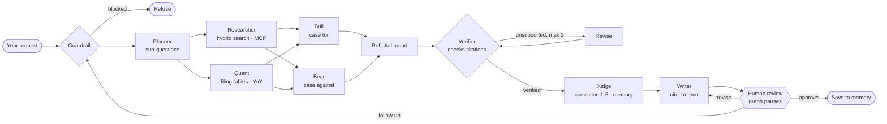

## How DealRoom works

DealRoom runs a small investment committee as a **LangGraph** state machine. Seven agents share one state
object (question, plan, evidence, metrics, claims, verdicts, memo), and a human approves the memo before
anything is saved.

| Agent | What it does | Tools |
|---|---|---|
| Guardrail | Blocks prompt injection, off-topic requests and companies outside the knowledge base; flags buy/sell questions | rules |
| Planner | Splits the request into sub-questions per company (growth, profitability, cash, risks, strategy, plus your focus) | LLM or rules |
| Researcher | Runs every sub-question as a hybrid search (Chroma dense + BM25 + RRF + rerank), in parallel | `search_filings` (in-process or over **MCP**) |
| Quant | Reads 12 key figures from the filings' own tables and computes year-over-year change | `key_metrics`, `compute_change` |
| Bull / Bear | Build the strongest case for and against from the same evidence, in parallel; each claim cites one passage and quotes it | LLM or extractive |
| Rebuttal | One round: Bear rebuts the Bull's best point, Bull responds | LLM or template |
| Verifier | Rejects claims whose quote is not on the cited page, whose numbers are not in the source, or whose company does not match; LLM judge on top in LLM mode | rules + LLM judge |
| Revise | Sends rejected claims back to their author for a supported replacement (max 2 loops) | same as Bull/Bear |
| Judge | Conviction 1-5 per company from verified claims and metrics, weighted by your mandate from memory | scoring |
| Writer | One-page memo with `[E#]` footnotes to filing pages; output guardrail strips buy/sell language and adds a disclaimer | LLM or template |
| Human review | `interrupt()` pauses the graph: approve, ask for changes, or ask a follow-up | LangGraph checkpointer |

**Memory.** Short-term: the LangGraph checkpointer keeps each thread so the reviewer can resume, revise or
follow up. Long-term: a per-reviewer store (`data/memory/store.json`) keeps the investing mandate, preferred
metrics and summaries of approved memos; the Judge and Writer read it.

**Two agent modes.** With `NEBIUS_API_KEY` (or `OPENAI_API_KEY`) the Planner, Bull, Bear, Rebuttal, Verifier
judge and Writer are LLM calls. Without a key, deterministic offline agents run the same graph, so the demo,
tests and CI never depend on an API. Any LLM failure falls back to the offline agent for that step.
